

<picture><source media="(prefers-color-scheme: dark)" srcset="./assets/svg/hero.svg"></picture>

  

<picture><source media="(prefers-color-scheme: dark)" srcset="./assets/svg/contributions.svg"></picture>

  

<table>
<tr>
<td valign="top"><picture><source media="(prefers-color-scheme: dark)" srcset="./assets/svg/portrait.svg"></picture></td>
<td valign="top"><picture><source media="(prefers-color-scheme: dark)" srcset="./assets/svg/stats.svg"></picture></td>
</tr>
</table>

<h3><code>karamo@github ~ $ ls ./pinned</code></h3>

<table>
<tr><td><a href="https://github.com/Kaaramo/SKILLNAV"><picture><source media="(prefers-color-scheme: dark)" srcset="./assets/svg/project-skillnav.svg"></picture></a></td><td><a href="https://github.com/Kaaramo/Radar"><picture><source media="(prefers-color-scheme: dark)" srcset="./assets/svg/project-radar.svg"></picture></a></td></tr>
<tr><td><a href="https://github.com/Kaaramo/Finance-CyberAttack-Analytics"><picture><source media="(prefers-color-scheme: dark)" srcset="./assets/svg/project-finance-cyberattack-analytics.svg"></picture></a></td><td><a href="https://github.com/Kaaramo/ai5d-digital-design-system"><picture><source media="(prefers-color-scheme: dark)" srcset="./assets/svg/project-ai5d-digital-design-system.svg"></picture></a></td></tr>
<tr><td><a href="https://github.com/Kaaramo/ai5d-auth"><picture><source media="(prefers-color-scheme: dark)" srcset="./assets/svg/project-ai5d-auth.svg"></picture></a></td><td><a href="https://github.com/Kaaramo/Vehicle-Damage-Detection"><picture><source media="(prefers-color-scheme: dark)" srcset="./assets/svg/project-vehicle-damage-detection.svg"></picture></a></td></tr>
</table>

 

<picture><source media="(prefers-color-scheme: dark)" srcset="./assets/svg/about.svg"></picture>

  

<picture><source media="(prefers-color-scheme: dark)" srcset="./assets/svg/stack.svg"></picture>

  

<a href="https://www.karamosylla.com/"><b>Portfolio</b></a> &nbsp;·&nbsp;
<a href="https://www.linkedin.com/in/syllakaramo/"><b>LinkedIn</b></a> &nbsp;·&nbsp;
<a href="https://ai5d.technology"><b>AI5D</b></a> &nbsp;·&nbsp;
<a href="https://ai5d.technology/azimut"><b>Azimut</b></a>

