  

<table>
<tr>
<td valign="top"></td>
<td valign="top"></td>
</tr>
</table>

  

  

<a href="https://www.karamosylla.com/"><b>Portfolio</b></a> &nbsp;·&nbsp;
<a href="https://www.linkedin.com/in/syllakaramo/"><b>LinkedIn</b></a> &nbsp;·&nbsp;
<a href="https://ai5d.technology/azimut"><b>Azimut</b></a> &nbsp;·&nbsp;
<a href="https://github.com/Kaaramo/SKILLNAV"><b>SKILLNAV</b></a> &nbsp;·&nbsp;
<a href="https://github.com/Kaaramo/Radar"><b>RADAR</b></a>

