<h3><code>karamo@github ~ $ neofetch</code></h3>

<table>
<tr>
<td valign="top"></td>
<td valign="top"></td>
</tr>
</table>

 

<h3><code>karamo@github ~ $ ./contributions.sh</code></h3>

  

<a href="https://www.karamosylla.com/">Portfolio</a> ·
<a href="https://www.linkedin.com/in/syllakaramo/">LinkedIn</a> ·
<a href="https://ai5d.technology/azimut">Azimut</a> ·
<a href="https://github.com/Kaaramo/SKILLNAV">SKILLNAV</a> ·
<a href="https://github.com/Kaaramo/Radar">RADAR</a>

